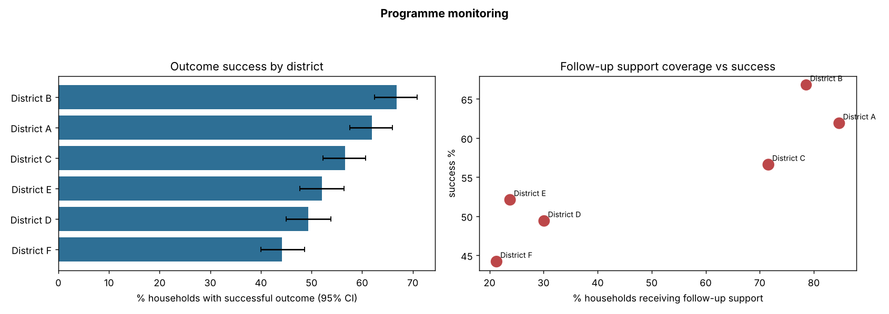

# Automated Donor Reporting for Development Programmes

> **Simulation-based case study.** 3,000 hypothetical households across 6 hypothetical districts. One script turns raw monitoring records into a donor-ready quarterly HTML report with statistics.



## What it does
- Headline indicators: reach, outcome success, median income gain, quarterly trend
- District comparison with **Wilson 95% confidence intervals** (honest about small samples)
- Tests whether follow-up support is associated with success: difference in proportions with 95% CI and a chi-square test
- Writes `outputs/quarterly_report.html` (self-contained, ready to email) and `outputs/summary.json`

## Results on the simulated data
| Metric | Value |
|---|---|
| Households | 3,000 |
| Success with vs without follow-up | 68.7% vs 40.5% |
| Difference | 28.2 percentage points (95% CI 24.8 to 31.6; chi-square 239.4, p < 0.001) |
| Report generation time | under 1 second |

**Caution written into the report:** the follow-up effect is observational. A staggered roll-out would let it be tested causally.

## Run
```bash
python3 -m unittest discover -s tests -v
python3 src/report.py
```
Requires: pandas, numpy, scipy, matplotlib.

Author: Mohammad Rabbani – Sustainability Data Analyst & Research Consultant

## Links
- Kaggle notebook: https://www.kaggle.com/rabbani0123 (runnable copy of `notebook.ipynb`)
- Author: Mohammad Rabbani | Sustainability Data Analyst & Research Assistant

## License
MIT
